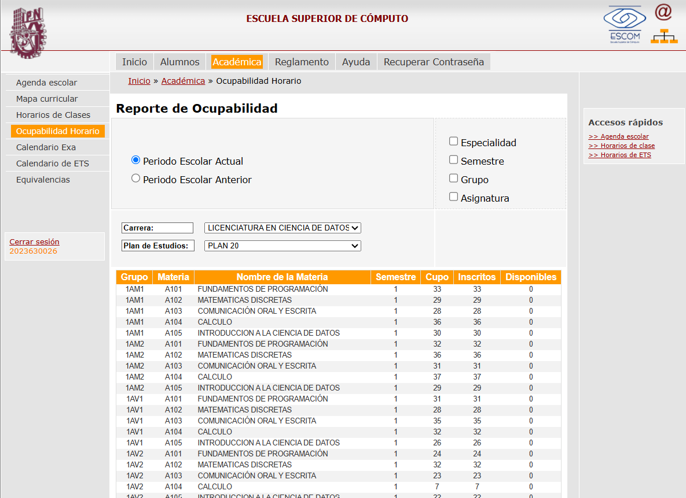
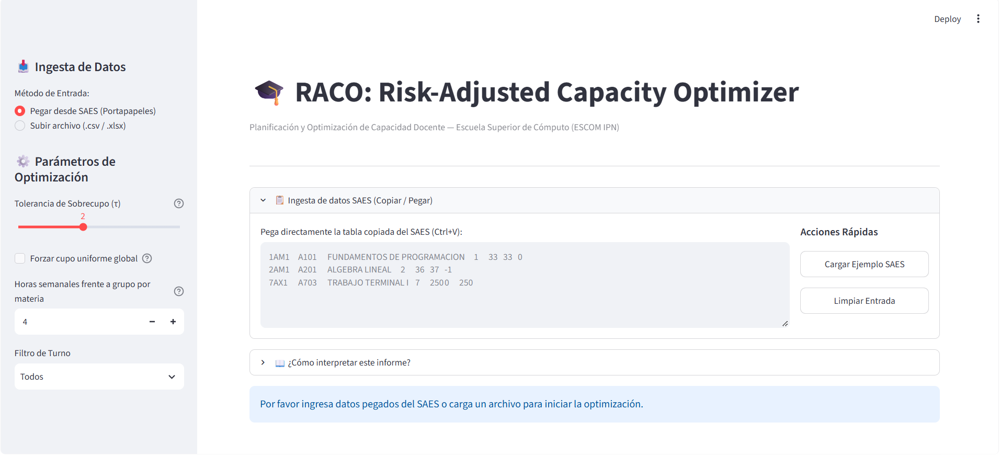
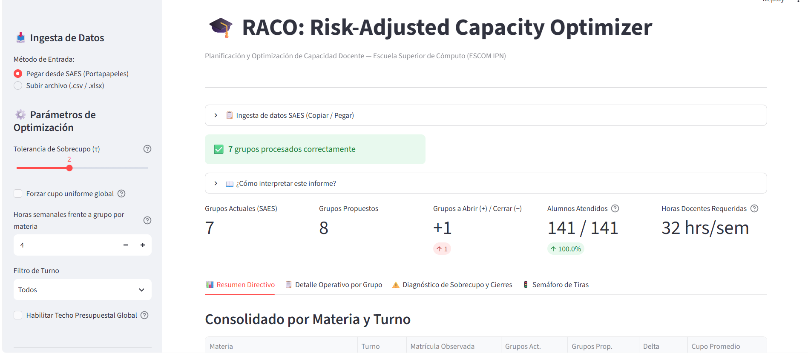
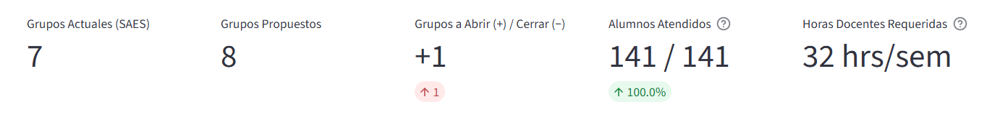
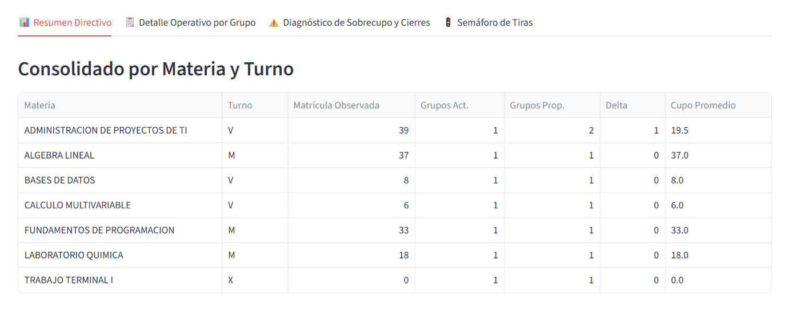
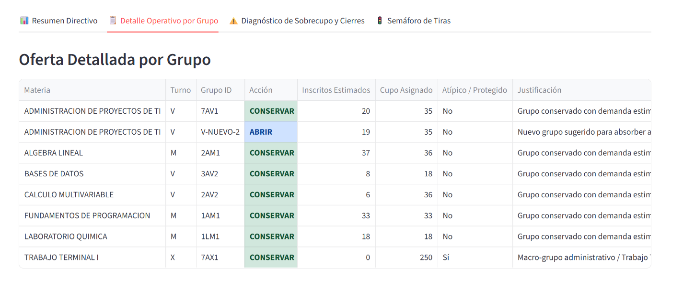
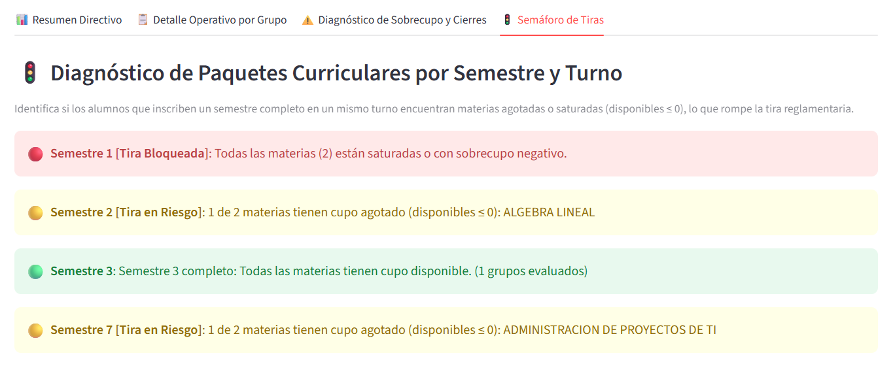
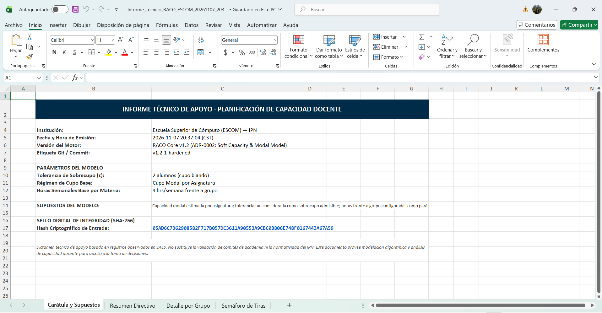

# MANUAL DE USUARIO Y GUÍA DE OPERACIÓN E2E — RACO v1.2

**Institución:** Instituto Politécnico Nacional (IPN) — Escuela Superior de Cómputo (ESCOM)  
**Sistema:** RACO (*Risk-Adjusted Capacity Optimizer*)  
**Versión del Motor:** `v1.2.1-hardened` (ADR-0001 & ADR-0002)  
**Clasificación:** Documento Técnico Operativo para Jefaturas de Departamento, Subdirección Académica y Academias  

---

## 1. Introducción y Propósito

**RACO (*Risk-Adjusted Capacity Optimizer*)** es una herramienta de soporte a la decisión diseñada específicamente para las Jefaturas de Departamento Académico y la Subdirección Académica de la **Escuela Superior de Cómputo (ESCOM - IPN)**. Su propósito es automatizar, en cuestión de segundos, el diagnóstico de ocupabilidad y la planeación de apertura, conservación o fusión de grupos docentes a partir de los reportes tabulares del **Sistema de Administración Escolar (SAES)**.

### Principios de Diseño Institucional

1. **Cero Costo ($0 MXN):** Desarrollado íntegramente sobre tecnologías de código abierto (*Python 3.12, Streamlit, Pydantic v2, Pandas, OpenPyXL*), sin licencias privativas ni costos de infraestructura.
2. **Cero Invasión al SAES (*Zero-Footprint*):** RACO no requiere credenciales administrativas, conexiones directas a la base de datos de SAES, ni instalación de agentes o extensiones en los equipos institucionales. Opera de forma 100% desacoplada aires-separados (*air-gapped* respecto al servidor del SAES).
3. **Ingesta por Portapapeles Tolerante a Fallos (ADR-0001):** Permite copiar directamente la tabla HTML de ocupabilidad desde el navegador web (`Ctrl+C`) y pegarla en RACO (`Ctrl+V`). El analizador léxico procesa tabuladores (`\t`), espacios múltiples, sobrecupos negativos (`-1` a `-4`) y nomenclaturas de grupos matutinos (`M`), vespertinos (`V`) y mixtos/administrativos (`X`).
4. **Optimización con Cupo Blando y Protección de Grupos Especiales (ADR-0002):** Incorpora la tolerancia operativa de sobrecupo ($\tau = 2$ alumnos por defecto), deduce automáticamente el **cupo modal** de cada asignatura y aísla de cualquier recorte o distorsión estadística tanto a los **laboratorios especializados** (cupo $\le 60\%$ del modal, ej. 18 plazas) como a los **macro-grupos administrativos de Trabajo Terminal** (`7AX1`, `8AX1`, cupo $\ge 100$ o turno `X`).

---

## 2. Flujo Operativo End-to-End (E2E) en 4 Pasos

El ciclo completo de trabajo —desde la consulta en el SAES hasta la emisión del informe técnico en Excel sellado criptográficamente— se ejecuta en **menos de 60 segundos** siguiendo cuatro pasos secuenciales.

---

### Paso 1: Captura de Ocupabilidad en SAES

1. Ingrese al portal del **SAES ESCOM** y navegue a la ruta:  
   **`Inicio » Académica » Ocupabilidad Horario`**.
2. Seleccione el **Periodo Escolar Actual**, la **Carrera** (por ejemplo, *Licenciatura en Ciencia de Datos*) y el **Plan de Estudios** correspondiente.
3. Con el cursor del ratón, seleccione las filas de la tabla de ocupabilidad (incluyendo o no la fila de encabezados `Grupo | Materia | Nombre de la Materia | Semestre | Cupo | Inscritos | Disponibles`) y presione **`Ctrl + C`** para copiarlas al portapapeles.

*Figura 1. Consulta del Reporte de Ocupabilidad Horario en el SAES (Licenciatura en Ciencia de Datos).*

---

### Paso 2: Interfaz e Ingesta en RACO

1. Al abrir **RACO**, visualizará el panel lateral izquierdo con las opciones de **Ingesta de Datos** y **Parámetros de Optimización**, junto con el panel central de recepción de datos.
2. Por defecto, se encuentra activo el método **"Pegar desde SAES (Portapapeles)"** (también puede optar por **"Subir archivo (.csv / .xlsx)"** si cuenta con un corte previamente exportado).

*Figura 2. Interfaz inicial de RACO con el área de pegado directo desde el portapapeles y botones de acciones rápidas.*

3. Pegue el contenido copiado del SAES dentro del cuadro de texto utilizando **`Ctrl + V`** (o utilice el botón **"Cargar Ejemplo SAES"** para realizar una simulación rápida).
4. En la barra lateral izquierda, ajuste los parámetros operativos según el criterio de la Jefatura:
   * **Tolerancia de Sobrecupo ($\tau$):** Margen de alumnos adicionales por grupo aceptable antes de proponer la apertura de una nueva sección (valor recomendado: `2`).
   * **Forzar cupo uniforme global:** Casilla opcional. Si permanece desmarcada (recomendado), RACO calcula el **Cupo Modal** propio de cada asignatura.
   * **Horas semanales frente a grupo por materia:** Parámetro para cuantificar el impacto en carga horaria docente (por defecto: `4` hrs/semana, rango de `1.0` a `12.0`).
   * **Filtro de Turno:** Permite analizar la oferta global (`Todos`) o segmentar por turno Matutino (`M`), Vespertino (`V`) o Mixto/Administrativo (`X`).
5. Una vez ingresados los datos, RACO valida instantáneamente cada registro y despliega el cintillo verde de confirmación con el **contador de grupos procesados**.

*Figura 3. Validación instantánea de la ingesta mostrando el contador de grupos procesados y el despliegue del tablero analítico.*

---

### Paso 3: Análisis y Diagnóstico en Pantalla

Una vez procesada la entrada, RACO estructura el diagnóstico en una barra superior de métricas globales y cuatro pestañas especializadas.

#### 3.1 KPIs Superiores y Horas Docentes

En la franja superior se presentan los **5 Indicadores Clave de Desempeño (KPIs)** consolidados en tiempo real:

* **Grupos Actuales (SAES):** Total de secciones registradas actualmente en la tabla ingresada.
* **Grupos Propuestos:** Total de secciones recomendadas por el algoritmo tras aplicar el modelo de capacidad ajustada al riesgo.
* **Grupos a Abrir (+) / Cerrar (-):** Diferencial neto ($\Delta$) de secciones requeridas.
* **Alumnos Atendidos:** Cobertura de matrícula asegurada respecto a la demanda total observada ($100\%$ bajo política de cero rechazo).
* **Horas Docentes Requeridas:** Estimación inmediata de horas-semana-mes frente a grupo necesarias para cubrir la oferta propuesta.

*Figura 4. Indicadores ejecutivos superiores: comparativa de grupos actuales vs. propuestos, cobertura estudiantil y horas docentes requeridas.*

#### 3.2 Resumen Directivo y Detección de Desbalances

La primera pestaña, **📊 Resumen Directivo**, agrupa la oferta por **Materia y Turno**, permitiendo identificar en una sola lectura qué asignaturas requieren abrir nuevos grupos, cuáles absorben su demanda mediante la tolerancia $\tau$ y cuáles presentan subocupación:

* **Absorción inteligente por Cupo Blando ($\tau$):** Como se observa en *Álgebra Lineal* (Turno `M`), con una matrícula de `37` alumnos sobre un cupo de `36`, la tolerancia $\tau = 2$ permite absorber al alumno excedente en el grupo actual (`Delta = 0`), evitando abrir un segundo grupo inviable para un solo estudiante.
* **Detección de Apertura Necesaria:** En *Administración de Proyectos de TI* (Turno `V`), la matrícula de `39` alumnos supera el umbral máximo permitido ($\text{Cupo } 35 + \tau = 37$), por lo que el motor dictamina pasar de `1` a `2` grupos (`Delta = +1`), equilibrando el cupo promedio en `19.5` alumnos por sección.

*Figura 5. Consolidado por Materia y Turno en la pestaña de Resumen Directivo.*

#### 3.3 Protección de Laboratorios y Macro-Grupos de Trabajo Terminal

La segunda pestaña, **📋 Detalle Operativo por Grupo**, desglosa la acción puntual recomendada para cada sección individual (`CONSERVAR`, `ABRIR` o `CERRAR`), incorporando el blindaje automático de infraestructura y grupos administrativos (**ADR-0002**):

* **Apertura de Nuevas Secciones (`ABRIR`):** Genera identificadores explícitos (ej. `V-NUEVO-2`) indicando los inscritos estimados y el cupo asignado tras el rebalanceo.
* **Respeto a Cupos de Laboratorio:** Grupos con capacidad restringida por equipamiento físico (como `1LM1` en *Laboratorio Química* con cupo de `18` plazas) conservan su tope físico sin ser forzados al cupo de aula teórica.
* **Blindaje de Macro-Grupos Administrativos (`Atípico / Protegido = Sí`):** Secciones especiales de titulación y seguimiento como *Trabajo Terminal I y II* (ej. `7AX1` en Turno `X` con cupo de `250` plazas) son aisladas automáticamente para que su alta capacidad administrativa no distorsione la moda estadística ni sea objeto de cierres automáticos cuando reportan `0` inscritos en etapas tempranas de inscripción.

*Figura 6. Desglose operativo por grupo mostrando acciones semánticas (`CONSERVAR` / `ABRIR`) y el blindaje de macro-grupos administrativos (`7AX1`).*

#### 3.4 Semáforo de Tiras Curriculares y Tiras Bloqueadas

La cuarta pestaña, **🚦 Semáforo de Tiras**, evalúa la viabilidad de inscripción desde la perspectiva de la trayectoria estudiantil por semestre, alertando cuando el agotamiento de cupos impide inscribir una carga reglamentaria completa:

* 🔴 **Tira Bloqueada (Rojo):** Todas las asignaturas evaluadas del semestre tienen disponibilidad nula o negativa ($\text{Disponibles} \le 0$). Ningún alumno de nuevo ingreso o reinscripción puede armar horario en ese bloque sin intervención inmediata.
* 🟡 **Tira en Riesgo (Amarillo):** Una o más asignaturas clave del semestre han agotado sus lugares disponibles, generando cuellos de botella que fragmentan los horarios estudiantiles (el sistema lista explícitamente las materias saturadas).
* 🟢 **Tira Saludable (Verde):** Todas las asignaturas del semestre cuentan con plazas disponibles para inscripción.

*Figura 7. Diagnóstico de paquetes curriculares por semestre con identificación automática de tiras bloqueadas y en riesgo.*

---

### Paso 4: Exportación y Trazabilidad Criptográfica (SHA-256)

Para formalizar el análisis ante las Academias, la Subdirección Académica o el Consejo Técnico Consultivo Escolar, RACO genera un libro de Microsoft Excel (`.xlsx`) mediante el botón **"📥 Descargar Informe Técnico (.xlsx)"** ubicado en la barra lateral.

El archivo exportado contiene **4 hojas formateadas profesionalmente**:
1. **`Carátula y Supuestos`:** Ficha técnica institucional con fecha y hora exacta de emisión, versión del motor, etiqueta de commit de Git, parámetros configurados ($\tau$, régimen de cupo, horas docentes), nota de descargo normativo y el **Sello Digital de Integridad SHA-256**.
2. **`Resumen Directivo`:** Tabla ejecutiva consolidada por materia y turno con formato condicional en deltas.
3. **`Detalle por Grupo`:** Listado operativo grupo por grupo con código de colores según acción (`ABRIR`, `CONSERVAR`, `CERRAR`) y columna de justificación técnica.
4. **`Semáforo de Tiras`:** Reporte de cuellos de botella curriculares por semestre y alertas de discrepancia aritmética detectadas en el SAES.

*Figura 8. Carátula del Informe Técnico exportado a Excel mostrando los supuestos del modelo y el Sello Digital de Integridad SHA-256.*

> **¿Para qué sirve el Sello SHA-256?**  
> El hash criptográfico de 64 caracteres hexadecimales se calcula sobre el lote de datos crudos normalizados ingresados al sistema. Garantiza trazabilidad total: dos corridas realizadas con el mismo corte del SAES producirán exactamente el mismo sello digital, permitiendo auditar y demostrar que la tabla original no fue alterada manualmente antes de la toma de decisiones.

---

## 3. Preguntas Frecuentes (FAQ) y Soporte Técnico

### ¿Por qué el SAES muestra números negativos en la columna "Disponibles" (ej. `-1`, `-3`)?
Durante los periodos de reinscripción e inscripción por comisaría en ESCOM, se autorizan sobrecupos manuales por encima de la capacidad nominal del salón. El SAES calcula $\text{Disponibles} = \text{Cupo} - \text{Inscritos}$, generando valores negativos. **RACO detecta y procesa nativamente estos valores**, emitiendo además un aviso informativo si detecta alguna discrepancia aritmética en el corte de origen.

### ¿Qué sucede si copio encabezados, líneas en blanco o texto adicional del navegador?
El módulo `core/parser.py` cuenta con filtrado heurístico automático: descarta líneas vacías, encabezados de tabla (`Grupo Materia Nombre...`) y pies de página, procesando exclusivamente los registros válidos que cumplen con la estructura de grupo politécnico (`[Semestre][Carrera][Turno][Secuencia]`, ej. `1AM1`, `3CV2`, `7AX1`).

### ¿Cómo distingue RACO entre un grupo con baja inscripción que debe cerrarse y un grupo de Trabajo Terminal?
RACO aplica la regla de aislamiento del **ADR-0002**: cualquier grupo perteneciente al turno mixto/administrativo (`Turno X`, ej. `7AX1`, `8AX1`) o con un cupo nominal $\ge 100$ plazas es clasificado automáticamente como **Macro-Grupo Administrativo Protegido**. Nunca se sugiere su cierre aunque temporalmente registre `0` inscritos en el SAES.

### ¿Se envían los datos de ESCOM a algún servidor externo?
No. Toda la ejecución matemática se realiza en la memoria volátil (`RAM`) de la sesión activa de Python y no almacena bases de datos persistentes ni transmite información a terceros.

---

### Ficha de Soporte y Mantenimiento

| Concepto | Detalle Institucional |
| :--- | :--- |
| **Unidad Académica** | Escuela Superior de Cómputo (ESCOM — IPN) |
| **Repositorio Oficial** | `github.com/angel-dev-18/raco-escom` |
| **Versión Documentada** | `v1.2.1-hardened` |
| **Suite de Verificación** | `pytest` — 42 pruebas unitarias y de integración automatizadas |
| **Contacto Técnico** | Subdirección Académica / Jefaturas de Departamento Académico ESCOM |
